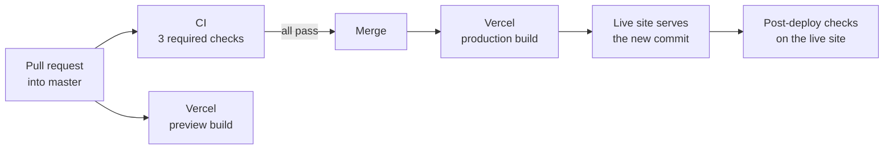

# Mihir Bhavsar — Portfolio

The source of my personal site. I'm a Cloud & DevOps engineer in Ahmedabad, India. I automate how Azure and AWS infrastructure is built, shipped and monitored, and I build applied AI.

**Live site: [mihirbhavsar.vercel.app](https://mihirbhavsar.vercel.app)**

<picture>
  <source media="(prefers-color-scheme: dark)" srcset="docs/images/home-dark.png">
  
</picture>

## About me

I'm a Cloud Operations Engineer at Parkar Global Technologies, where I've automated multi-client Azure and AWS environments since December 2024, mostly with infrastructure as code and delivery pipelines. A few results, each explained on the site:

- **40%** faster Azure Virtual Desktop deployments across clients, from about 8 hours to about 5
- **99.9%** uptime on a multi-AZ WordPress platform on AWS
- **~60%** faster HR policy query resolution, from a retrieval-augmented assistant shipped as an internal tool

## What's on the site

- **What I do, on the first screen**, beside a live diagram of my workloads.
- **Measured outcomes** with how each was achieved, tied to a service map that lights up whatever produced it.
- **Four case studies** with architecture diagrams: [Azure Virtual Desktop automation](content/work/avd-automation.mdx), a [multi-AZ AWS web platform](content/work/aws-web-platform.mdx), an [HR policy assistant](content/work/hr-policy-assistant.mdx) and a [DevSecOps CI/CD pipeline](content/work/devsecops-pipeline.mdx).

Then experience, stack, credentials and contact. The visual system, in light and dark themes, is in [DESIGN.md](DESIGN.md).

## Tech stack

| Area | Choice |
| --- | --- |
| Framework | Next.js 16 (App Router), React 19, TypeScript |
| Styling | Tailwind CSS v4 with CSS-first design tokens; light and dark themes |
| UI | Radix UI primitives, lucide-react icons |
| Content | One typed data file for every fact; MDX for the case-study narratives |
| Diagrams and motion | Server-rendered SVG and plain CSS, with no diagram or animation library in the browser |
| Testing | Vitest, plus a headless-browser verifier that also runs axe-core on every page |
| Hosting | Vercel; a Dockerfile also builds a standalone Node server for container hosts |

## How it's built

- **Every fact has one source.** Roles, figures, projects, skills and credentials live in [lib/resume-data.ts](lib/resume-data.ts). Each figure carries the sentence that explains it, and tests fail if a retired or unsourced claim creeps back into the copy.
- **Accessible by default.** Every text colour pairing passes WCAG AA contrast in both themes, and a test holds it there. The whole site works from the keyboard, respects reduced-motion settings and shows all its content with JavaScript off.
- **Easy to find and share.** The home page and each case study have their own canonical URL, share image and structured data, and the sitemap lists them all.

## How a change ships

1. **Pull request.** Every change reaches `master` through a pull request, including Dependabot's weekly updates. [CI](.github/workflows/ci.yml) runs three checks: lint, types and unit tests; a dependency audit with registry signature checks; and a production build that [the browser verifier](scripts/verify-ui.mjs) tests in headless Chrome across both themes, phone to desktop widths, keyboard focus, reduced motion and JavaScript off. Vercel also builds a preview of the branch.
2. **Merge.** A [ruleset](.github/rulesets/master.json) blocks direct pushes and force-pushes. It allows a merge only when all three checks pass on a branch that is up to date with `master`.
3. **Deploy.** Vercel builds the merged commit and points the live domain at it. Every response carries an `X-Commit` header naming the commit it was built from.
4. **Verify.** [A second workflow](.github/workflows/post-deploy.yml) waits until the live site's `X-Commit` matches the merge, then runs the same browser checks against it. It also confirms that canonical URLs, the sitemap and share images point at the live domain. It runs again every day, so a fault that appears between merges still fails a run. If it fails, GitHub emails whoever merged.

## Repository layout

| Path | What it holds |
| --- | --- |
| [lib/resume-data.ts](lib/resume-data.ts) | Everything the site says: roles, figures and their provenance, projects, skills, credentials, links |
| [content/work/](content/work/) | Case-study narratives in MDX, and each diagram's data |
| [app/](app/) | Routes: the home page, the case studies, share images, the sitemap, robots and the 404 page |
| [components/](components/) | Site chrome, the hero and map, home sections, case-study parts, diagrams and share cards |
| [DESIGN.md](DESIGN.md) | The visual system: colours, type, components and rules |

## Contact

- **Email:** [mihirbhavsar2001@gmail.com](mailto:mihirbhavsar2001@gmail.com)
- **LinkedIn:** [linkedin.com/in/mihirbhavsar3102](https://www.linkedin.com/in/mihirbhavsar3102/)
- **GitHub:** [@MihirBhavsar3102](https://github.com/MihirBhavsar3102)
- **Resume:** [MihirBhavsar_Resume.pdf](public/MihirBhavsar_Resume.pdf)

## Using this code

This is my personal site. You're welcome to read the code and borrow ideas from it, but please don't reuse its content (the writing, case studies and resume) or present the site as your own.

The Schibsted Grotesk files in [assets/fonts/](assets/fonts/) are under the SIL Open Font License ([OFL.txt](assets/fonts/OFL.txt)).
