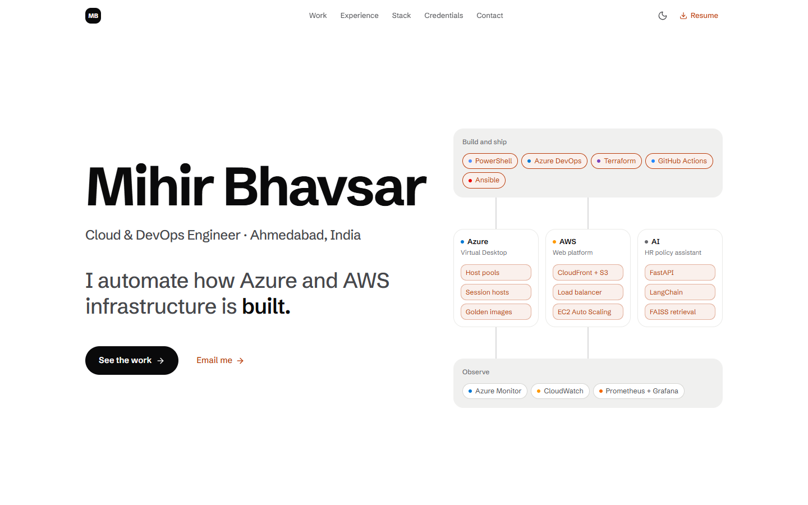

# Mihir Bhavsar — Portfolio

The source of my personal site. I'm a Cloud & DevOps engineer in Ahmedabad, India. I automate how Azure and AWS infrastructure is built, shipped and monitored, and I build applied AI.

<picture>
  <source media="(prefers-color-scheme: dark)" srcset="docs/images/home-dark.png">
  
</picture>

## About me

I'm a Cloud Operations Engineer at Parkar Global Technologies, where I've worked across AWS, Azure and GCP since December 2024. Most of my work is infrastructure as code and delivery pipelines with Terraform, GitHub Actions and Azure DevOps, along with Linux administration and monitoring with Prometheus, Grafana and CloudWatch. I've also used Docker, Kubernetes, Helm and ArgoCD in project work.

Some results from that work. The site explains how each one was achieved:

- **40%** faster Azure Virtual Desktop deployments across clients, from about 8 hours to about 5
- **70%+** less manual effort across five clients, with configuration errors near zero
- **450+** concurrent virtual desktop users supported
- **99.9%** uptime on a multi-AZ WordPress platform on AWS
- **~60%** faster answers to HR policy questions, from a retrieval-augmented assistant

**Certifications:** AWS Certified Solutions Architect – Associate, AWS Certified Cloud Practitioner, Microsoft Certified: Azure Fundamentals and Azure AI Fundamentals, and Google Cloud Digital Leader.

**Education:** B.E. in Computer Science and Engineering from The Maharaja Sayajirao University of Baroda, after a diploma in Computer Engineering from Gujarat Technological University.

## What's on the site

- **What I do, on the first screen.** One line whose last word rolls through *built*, *shipped* and *monitored*, beside a small live diagram of my workloads that lights up the matching step.
- **Measured outcomes.** Six figures set large, each with the sentence that says how it was achieved and, where known, how it was measured.
- **How it fits together.** A service map of three workloads under one way of building and monitoring them. Pick a figure and the map lights up whatever produced it.
- **Selected work.** Four case studies, each with its own page and architecture diagram: [Azure Virtual Desktop automation](content/work/avd-automation.mdx), a [multi-AZ AWS web platform](content/work/aws-web-platform.mdx), an [HR policy assistant](content/work/hr-policy-assistant.mdx) and a [DevSecOps CI/CD pipeline](content/work/devsecops-pipeline.mdx).
- **Experience, stack, credentials, GitHub and contact.** Skills I've used at work or in a project are marked that way. The GitHub section shows hand-picked repositories with live details.

The design reads like a product launch page: one idea per screen, big type, white or black backgrounds and one accent colour, in light and dark themes. The full visual system is in [DESIGN.md](DESIGN.md).

## Tech stack

| Area | Choice |
| --- | --- |
| Framework | Next.js 16 (App Router), React 19, TypeScript |
| Styling | Tailwind CSS v4 with CSS-first design tokens; light and dark themes |
| UI | Radix UI primitives, lucide-react icons |
| Content | One typed data file for every fact; MDX for the case-study narratives |
| Diagrams | Server-rendered SVG, with no diagram library in the browser |
| Motion | Plain CSS, with no animation library |
| Share images | Generated for each page with `next/og` |
| Fonts | Schibsted Grotesk and Fragment Mono through `next/font` |
| Testing | Vitest, plus a headless-browser verifier with no dependencies |
| Hosting | A standalone Node server in a Docker image |

## How it's built

- **Every fact has one source.** Roles, figures, projects, skills and credentials live in [lib/resume-data.ts](lib/resume-data.ts). Each figure carries the sentence that explains it. Tests fail if a retired or unsourced claim creeps back into the copy, or if my phone number appears anywhere.
- **Accessible by default.** Every text colour pairing passes WCAG AA contrast in both themes, and a test holds it there. The whole site works from the keyboard, respects reduced-motion settings and shows all its content with JavaScript off.
- **Light on the browser.** The map and the case-study diagrams render on the server, motion is plain CSS, and no animation or diagram library is sent to the browser.
- **Easy to find and share.** The home page and each case study have their own canonical URL, share image and structured data, and the sitemap lists them all.
- **Checked in a real browser.** [A script](scripts/verify-ui.mjs) drives headless Microsoft Edge to test the map's interactions, keyboard focus, both themes, widths from phone to desktop, reduced motion and JavaScript-off rendering.
- **Live GitHub data, with a fallback.** Repository details refresh hourly. When GitHub can't be reached, the section shows curated descriptions instead.

## Repository layout

| Path | What it holds |
| --- | --- |
| [lib/resume-data.ts](lib/resume-data.ts) | Everything the site says: roles, figures and their provenance, projects, skills, credentials, links |
| [content/work/](content/work/) | Case-study narratives in MDX, and each diagram's data |
| [app/](app/) | Routes: the home page, the case studies, share images, the sitemap, robots and the 404 page |
| [components/](components/) | Site chrome, the hero and map, home sections, case-study parts, diagrams and share cards |
| [tests/](tests/) | Unit, render, content and contrast tests |
| [DESIGN.md](DESIGN.md) | The visual system: colours, type, components and rules |
| [PRODUCT.md](PRODUCT.md) | Who the site is for and what it has to show |

## Contact

- **Email:** [mihirbhavsar2001@gmail.com](mailto:mihirbhavsar2001@gmail.com)
- **LinkedIn:** [linkedin.com/in/mihirbhavsar3102](https://www.linkedin.com/in/mihirbhavsar3102/)
- **GitHub:** [@MihirBhavsar3102](https://github.com/MihirBhavsar3102)
- **Resume:** [MihirBhavsar_Resume.pdf](public/MihirBhavsar_Resume.pdf)

## Using this code

This is my personal site. You're welcome to read the code and borrow ideas from it, but please don't reuse its content (the writing, case studies and resume) or present the site as your own.

The Schibsted Grotesk files in [assets/fonts/](assets/fonts/) are under the SIL Open Font License ([OFL.txt](assets/fonts/OFL.txt)).
